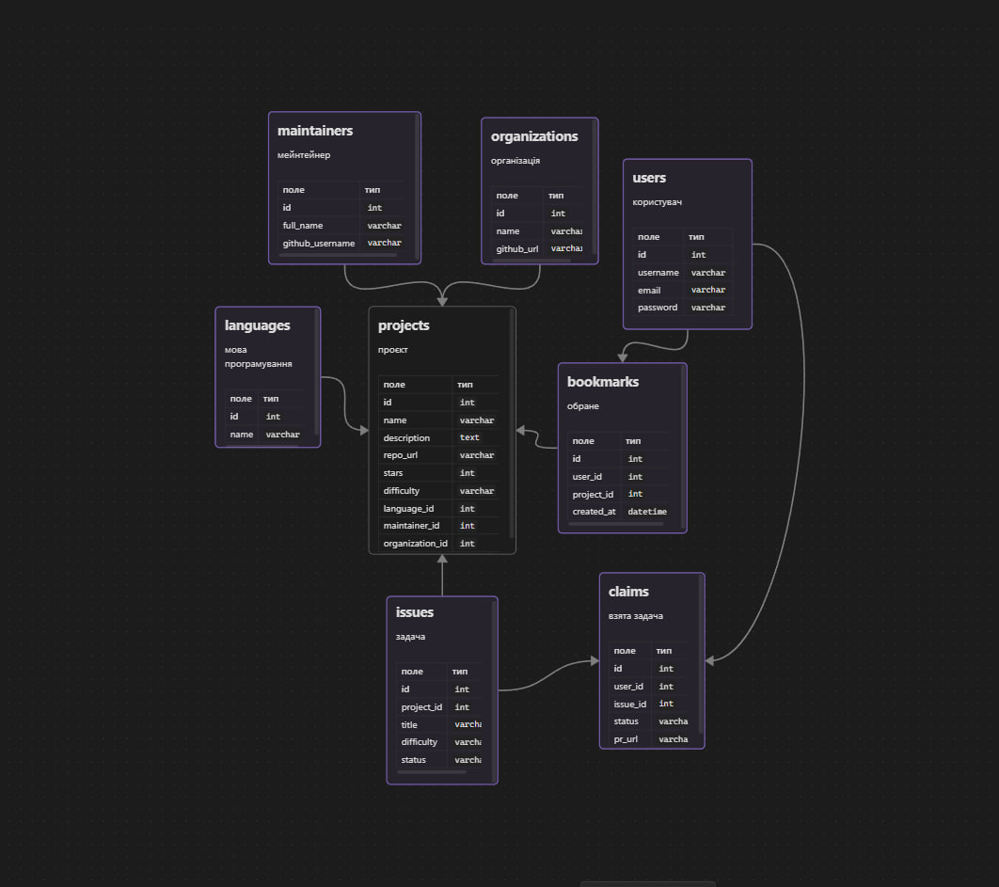

# rest-api

Каталог open-source проєктів для новачків: знаходиш проєкт під свою мову і просту задачу, з якої можна почати.

На сайті: каталог проєктів з пошуком і фільтрами, сторінки проєктів, задач, мейнтейнерів і організацій, реєстрація, профіль, обране і "взяти задачу". Адмін може додавати, редагувати і видаляти дані.

## API

Базовий шлях `/api/v1/`, формат JSON. Помилка: `{ "detail": "..." }`

| Метод | URL | Що робить | Параметри / body | Відповідь |
|---|---|---|---|---|
| GET | `/projects/` | список проєктів | `search`, `language`, `topic`, `difficulty`, `ordering` | `200` [проєкт] |
| GET | `/projects/{id}/` | один проєкт | - | `200` проєкт, `404` |
| POST | `/projects/` | додати проєкт | проєкт | `201` проєкт, `400` |
| PATCH | `/projects/{id}/` | змінити проєкт | змінені поля | `200` проєкт, `400`, `404` |
| DELETE | `/projects/{id}/` | видалити проєкт | - | `204`, `404` |
| GET | `/issues/` | список задач | `difficulty`, `status`, `project` | `200` [задача] |
| GET | `/issues/{id}/` | одна задача | - | `200` задача, `404` |
| POST | `/issues/` | додати задачу | задача | `201` задача, `400` |
| PATCH | `/issues/{id}/` | змінити задачу | змінені поля | `200` задача, `400`, `404` |
| DELETE | `/issues/{id}/` | видалити задачу | - | `204`, `404` |
| GET | `/maintainers/`, `/organizations/` | список | `search` | `200` [обʼєкт] |
| GET | `/maintainers/{id}/projects/`, `/organizations/{id}/projects/` | їх проєкти | - | `200` [проєкт], `404` |
| POST / PATCH / DELETE | `/maintainers/{id}/`, `/organizations/{id}/` | додати / змінити / видалити | обʼєкт | `201` / `200` / `204`, `400`, `404` |
| POST | `/auth/register/` | реєстрація | `username`, `email`, `password` | `201` користувач, `400` |
| POST | `/auth/login/` | логін | `username`, `password` | `200` користувач, `401` |
| GET | `/profile/` | мій профіль | - | `200` користувач, `401` |
| PATCH | `/profile/` | змінити профіль | змінені поля | `200` користувач, `400` |
| GET | `/profile/bookmarks/` | моє обране | - | `200` [проєкт] |
| POST | `/profile/bookmarks/` | додати в обране | `project_id` | `201`, `400` |
| POST | `/claims/` | взяти задачу | `issue_id` | `201` claim, `400` |
| GET | `/profile/claims/` | мої взяті задачі | - | `200` [claim] |

Проєкт:

```json
{ "id": 1, "name": "Django", "repo_url": "https://github.com/django/django", "stars": 81000, "difficulty": "beginner", "languages": ["Python"], "organization_id": 1 }
```

Задача:

```json
{ "id": 1, "project_id": 1, "title": "Fix typo in docs", "difficulty": "beginner", "status": "open" }
```

Користувач:

```json
{ "id": 1, "username": "ivan_p", "email": "user@example.com" }
```

Claim (взята задача):

```json
{ "id": 1, "issue_id": 1, "status": "in_progress", "pr_url": null }
```

## Схема бази даних



## TODO

- [ ] TBD: авторизація 
- [ ] пошук і фільтри для задач по мові програмування
- [ ] підтягувати зірки і задачі з GitHub API автоматично
- [ ] сторінка "Про нас"