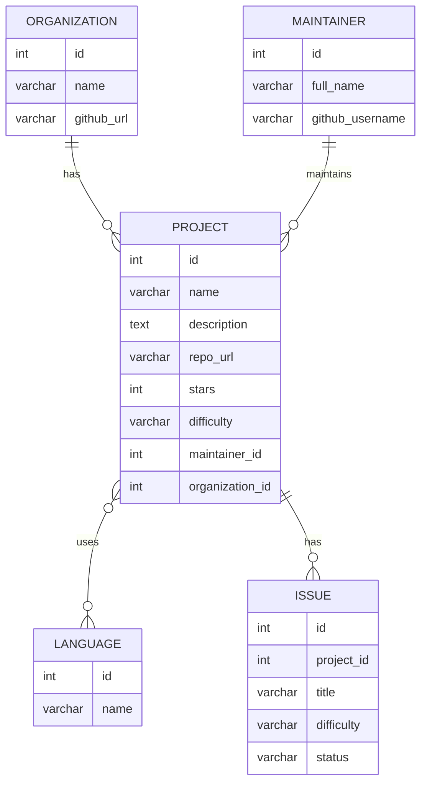

# rest-api

Каталог open-source проєктів для новачків: знаходиш проєкт під свою мову і просту задачу, з якої можна почати.

На сайті: каталог проєктів з пошуком і фільтрами, сторінки проєктів, задач, мейнтейнерів і організацій, реєстрація, профіль, обране і "взяти задачу". Адмін може додавати, редагувати і видаляти дані.

Зараз зроблено бекенд для каталогу: CRUD для мов, організацій, мейнтейнерів, проєктів і задач. Реєстрація, профіль, обране і "взяти задачу" будуть у наступних частинах.

## Як запустити проєкт

Потрібен Python 3.12 або новіший.

```bash
git clone https://github.com/zxkeee/rest-api.git
cd rest-api
python -m venv .venv
.venv\Scripts\activate
pip install -r requirements.txt
copy .env.example .env
python manage.py migrate
python manage.py runserver
```

На macOS і Linux замість `.venv\Scripts\activate` пиши `source .venv/bin/activate`, а замість `copy` пиши `cp`.

У `.env` впиши свій `SECRET_KEY` (будь-який довгий випадковий рядок). Файл `.env` не комітиться.

`migrate` створює таблиці і заповнює базу демо-даними: 5 мов, 4 організації, 4 мейнтейнери, 5 проєктів і 6 задач.

Сервер працює на http://127.0.0.1:8000, API на http://127.0.0.1:8000/api/v1/. CORS дозволений для фронтенду на http://localhost:8001 і http://127.0.0.1:8001.

## API

Базовий шлях `/api/v1/`, формат JSON. Оновлення тільки через `PATCH`: передаєш лише ті поля, які змінюєш.

| Метод | URL | Що робить | Параметри / body | Відповідь |
|---|---|---|---|---|
| GET | `/projects/` | список проєктів | `search`, `language`, `difficulty`, `ordering` | `200` [проєкт], `400` |
| POST | `/projects/` | додати проєкт | проєкт | `201` проєкт, `400` |
| GET | `/projects/{id}/` | один проєкт | - | `200` проєкт, `404` |
| PATCH | `/projects/{id}/` | змінити проєкт | змінені поля | `200` проєкт, `400`, `404` |
| DELETE | `/projects/{id}/` | видалити проєкт | - | `204`, `404`, `409` |
| GET | `/issues/` | список задач | `difficulty`, `status`, `project` | `200` [задача], `400` |
| POST | `/issues/` | додати задачу | задача | `201` задача, `400` |
| GET | `/issues/{id}/` | одна задача | - | `200` задача, `404` |
| PATCH | `/issues/{id}/` | змінити задачу | змінені поля | `200` задача, `400`, `404` |
| DELETE | `/issues/{id}/` | видалити задачу | - | `204`, `404` |
| GET | `/maintainers/` | список мейнтейнерів | `search` | `200` [мейнтейнер] |
| POST | `/maintainers/` | додати мейнтейнера | мейнтейнер | `201` мейнтейнер, `400` |
| GET | `/maintainers/{id}/` | один мейнтейнер | - | `200` мейнтейнер, `404` |
| PATCH | `/maintainers/{id}/` | змінити мейнтейнера | змінені поля | `200` мейнтейнер, `400`, `404` |
| DELETE | `/maintainers/{id}/` | видалити мейнтейнера | - | `204`, `404`, `409` |
| GET | `/maintainers/{id}/projects/` | його проєкти | - | `200` [проєкт], `404` |
| GET | `/organizations/` | список організацій | `search` | `200` [організація] |
| POST | `/organizations/` | додати організацію | організація | `201` організація, `400` |
| GET | `/organizations/{id}/` | одна організація | - | `200` організація, `404` |
| PATCH | `/organizations/{id}/` | змінити організацію | змінені поля | `200` організація, `400`, `404` |
| DELETE | `/organizations/{id}/` | видалити організацію | - | `204`, `404`, `409` |
| GET | `/organizations/{id}/projects/` | її проєкти | - | `200` [проєкт], `404` |
| GET | `/languages/` | список мов | - | `200` [мова] |
| POST | `/languages/` | додати мову | мова | `201` мова, `400` |
| GET | `/languages/{id}/` | одна мова | - | `200` мова, `404` |
| PATCH | `/languages/{id}/` | змінити мову | змінені поля | `200` мова, `400`, `404` |
| DELETE | `/languages/{id}/` | видалити мову | - | `204`, `404`, `409` |

Параметри фільтрів:

- `search` шукає за назвою проєкту чи організації або за іменем мейнтейнера, без урахування регістру.
- `language` приймає назву мови: `/projects/?language=python`.
- `difficulty` приймає `beginner`, `intermediate` або `advanced`.
- `ordering` приймає `name`, `-name`, `stars` або `-stars` (мінус означає спадання).
- `status` задачі приймає `open`, `in_progress` або `closed`.
- `project` приймає id проєкту: `/issues/?project=1`.

Невідоме значення фільтра повертає `400` зі списком допустимих значень.

### Обʼєкти

Проєкт. `languages` це список id мов, `maintainer` і `organization` це id. `description` можна не передавати. Хоча б одна мова обовʼязкова, `stars` не може бути відʼємним, `repo_url` має починатися з `https://github.com/` і не повторюватися.

```json
{ "id": 1, "name": "Django", "description": "The web framework for perfectionists with deadlines.", "repo_url": "https://github.com/django/django", "stars": 81000, "difficulty": "intermediate", "languages": [1, 2], "maintainer": 2, "organization": 1 }
```

Задача. `status` за замовчуванням `open`.

```json
{ "id": 1, "project": 1, "title": "Fix typo in tutorial part 2", "difficulty": "beginner", "status": "open" }
```

Мейнтейнер. `github_username` унікальний.

```json
{ "id": 2, "full_name": "Sarah Boyce", "github_username": "sarahboyce" }
```

Організація. `github_url` має починатися з `https://github.com/`.

```json
{ "id": 1, "name": "Django Software Foundation", "github_url": "https://github.com/django" }
```

Мова. `name` унікальна.

```json
{ "id": 1, "name": "Python" }
```

## Помилки

Усі ендпоінти повертають помилку в одному форматі:

```json
{ "status": 409, "detail": "Неможливо видалити організацію «Microsoft», оскільки за нею закріплено 2 проєкти. Спочатку видаліть ці проєкти або перенесіть їх в іншу організацію.", "errors": null }
```

`detail` пояснює, що сталося і що робити. `errors` заповнений тільки коли не пройшли перевірку поля, тоді там помилки по кожному полю:

```json
{ "status": 400, "detail": "Невалідні дані. Деталі в полі errors.", "errors": { "stars": ["Кількість зірок не може бути відʼємною."] } }
```

| Статус | Коли | Чому цей статус |
|---|---|---|
| `400` | невалідні поля, битий JSON, невідоме значення фільтра, id неіснуючого обʼєкта в body | помилка в самому запиті, його треба виправити |
| `404` | обʼєкта з id з URL немає | ресурсу, до якого звертаються, не існує |
| `405` | метод не підтримується, наприклад `PUT` | для оновлення є тільки `PATCH` |
| `409` | дія порушує правило каталогу (див. нижче) | запит правильний, але конфліктує з поточними даними; коли прибрати причину, той самий запит пройде |

Якщо в body передати `"project": 999`, а такого проєкту немає, буде `400`, а не `404`. `404` означає, що немає ресурсу з URL, а тут помилка в даних запиту.

Правила, які повертають `409`:

- організацію не можна видалити, поки за нею є проєкти;
- мейнтейнера не можна видалити, поки за ним є проєкти;
- мову не можна видалити, поки її використовує хоча б один проєкт;
- проєкт не можна видалити, поки в нього є задачі зі статусом `open` або `in_progress`.

Коли проєкт видаляється, його закриті задачі видаляються разом з ним.

## Схема бази даних



Проєкт і мова повʼязані через проміжну таблицю, бо в одного проєкту може бути кілька мов.

## TODO

- [ ] авторизація: `/auth/register/`, `/auth/login/`
- [ ] профіль: `/profile/`
- [ ] обране: `/profile/bookmarks/`
- [ ] "взяти задачу": `/claims/`, `/profile/claims/`
- [ ] пошук і фільтри для задач по мові програмування
- [ ] підтягувати зірки і задачі з GitHub API автоматично
- [ ] сторінка "Про нас"
